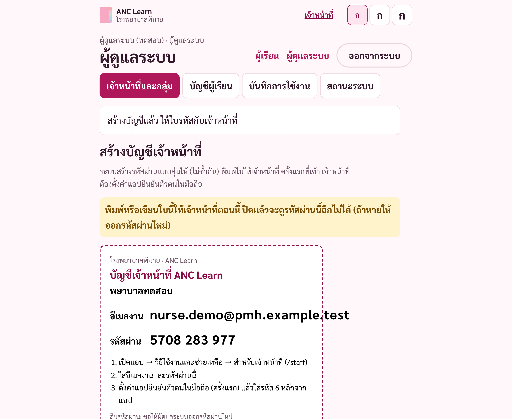

# คู่มือผู้ดูแลระบบ (ANC Learn)

> ฉบับร่าง (11 พ.ย. 2569) ระบบบัญชียังไม่เปิดใช้จริง ภาพมาจากแอปจริงในเครื่องทดสอบ ข้อมูลสมมุติ
> สิทธิ์ผู้ดูแลระบบใช้จัดการบัญชีเท่านั้น **ไม่ใช่** สิทธิ์อนุมัติหรือแก้ไขเนื้อหาทางการแพทย์ (CONTENT_REVIEW.md)

เข้าสู่ระบบเหมือนเจ้าหน้าที่ (docs/ACCOUNTS-STAFF-GUIDE.md ข้อ 1) แล้วแตะ **ผู้ดูแลระบบ** ด้านบน

## 1. สร้างบัญชีเจ้าหน้าที่หรือผู้ดูแลระบบ
แท็บ **เจ้าหน้าที่และกลุ่ม** → สร้างบัญชีเจ้าหน้าที่: อีเมลงาน (ใช้เป็นชื่อเข้าระบบ ไม่มีการส่งอีเมล), ชื่อที่แสดง, บทบาท → **สร้างบัญชี**
- ระบบสร้างรหัสผ่าน 10 หลักแบบสุ่ม (ไม่ซ้ำกัน ไม่มีรหัสกลางของโรงพยาบาล) → **พิมพ์ใบนี้** ให้เจ้าหน้าที่ แล้วปิดใบ (ดูอีกไม่ได้)
- ครั้งแรกที่เข้า เจ้าหน้าที่ต้องตั้งค่าแอปยืนยันตัวตนในมือถือ ทุกครั้งต่อไปใช้รหัสผ่าน + รหัสจากแอป
- อีเมลที่มีบัญชีอยู่แล้วใช้ซ้ำไม่ได้
- บัญชีใหม่ยังไม่เห็นผู้เรียนคนใด จนกว่าจะติ๊กกลุ่มให้ (ข้อ 2)
- **ลืมรหัสผ่าน / ทำมือถือที่มีแอปยืนยันตัวตนหาย:** ที่ชื่อเจ้าหน้าที่ → **ออกรหัสผ่านใหม่** (เลือกว่าต้องตั้งค่าแอปยืนยันตัวตนใหม่ด้วยหรือไม่)




## 2. ตั้งสิทธิ์
- **บทบาท:** เจ้าหน้าที่ = สร้างบัญชีผู้เรียนและดูผู้เรียนในกลุ่มที่ได้รับ; ผู้ดูแลระบบ = จัดการบัญชีและสิทธิ์ (สร้างบัญชีผู้เรียนในทุกกลุ่มได้)
- **กลุ่ม:** สร้างกลุ่ม (เช่น “คลินิกฝากครรภ์”, “คลินิกเด็กดี”) แล้วติ๊กกลุ่มให้เจ้าหน้าที่แต่ละคน เจ้าหน้าที่เห็นเฉพาะผู้เรียนในกลุ่มที่ติ๊ก
- **ผู้เรียน:** แท็บ **บัญชีผู้เรียน** → ติ๊กกลุ่มให้ผู้เรียน (หน้านี้ไม่แสดงความคืบหน้าการเรียน)


## 3. ถอนสิทธิ์
- ถอนกลุ่ม: เอาติ๊กออก มีผลทันที แม้เจ้าหน้าที่ยังเปิดหน้าอยู่
- ปิดบัญชีเจ้าหน้าที่: **ปิดใช้งานบัญชี** มีผลทันที ทำเมื่อย้ายงาน ลาออก หรือสงสัยว่าบัญชีรั่ว
- ระบบไม่ยอมปิดหรือลดสิทธิ์ผู้ดูแลระบบคนสุดท้าย ควรมีผู้ดูแลระบบที่ใช้งานอย่างน้อย 2 คน

## 4. กู้คืนบัญชี (ต้องให้โรงพยาบาลอนุมัติขั้นตอนก่อนใช้จริง)
| กรณี | ทำอย่างไร (ร่าง) |
|---|---|
| (ถ้าเปิดใช้การเข้าด้วย SMS/อีเมล) ผู้เรียนเปลี่ยนเบอร์ / ใช้อีเมลเดิมไม่ได้ | ตรวจตัวตนต่อหน้าตามระเบียบโรงพยาบาล → เจ้าหน้าที่ผู้ดูแลฐานข้อมูลเปลี่ยนเบอร์/อีเมลในระบบ Auth (ต้องใช้กุญแจลับ ไม่มีในแอป) → บันทึกเหตุผล |
| เบอร์เดิมถูกนำไปใช้ซ้ำ (เบอร์รีไซเคิล) | ปิดใช้งานบัญชีเดิม แล้วให้ผู้เรียนสมัครใหม่ ห้ามโอนข้อมูลให้เจ้าของเบอร์ใหม่ |
| คนในบ้านใช้มือถือร่วมกัน | แต่ละคนใช้บัญชีของตัวเอง ออกจากระบบทุกครั้ง |
| สงสัยว่าเป็นคนเดียวกันแต่มี 2 บัญชี | **ห้ามรวมบัญชีเพราะชื่อเหมือนกัน** ปิดบัญชีที่ไม่ใช้ หลังตรวจตัวตนแล้วเท่านั้น |
| เจ้าหน้าที่ทำมือถือที่มีแอปยืนยันตัวตนหาย | **ออกรหัสผ่านใหม่** และเลือกให้ตั้งค่าแอปยืนยันตัวตนใหม่ (ข้อ 1) |
| ผู้เรียนลืมรหัสผ่าน / ทำใบหาย | เจ้าหน้าที่ในกลุ่มนั้นหรือผู้ดูแลระบบ → ข้อมูลผู้เรียน → **ออกรหัสผ่านใหม่** ตรวจตัวตนก่อนให้ใบ |
| ลบบัญชี (เช่น เด็กอายุครบตามที่โรงพยาบาลกำหนด) | แท็บ **บัญชีผู้เรียน** → **ลบบัญชี** → พิมพ์เหตุผล → ตกลง ชื่อ เบอร์/อีเมล และการเข้าสู่ระบบถูกลบทันที ข้อมูลการเรียนแบบไม่ระบุตัวตนเก็บ 5 ปีเพื่อการวิจัย แล้วระบบลบเอง ย้อนกลับไม่ได้ |

ยังไม่มีปุ่มในแอปสำหรับการเปลี่ยนเบอร์/อีเมล (ตั้งใจให้ทำโดยผู้ดูแลฐานข้อมูลตามขั้นตอนที่อนุมัติ)

## 5. ดูบันทึกการใช้งาน
แท็บ **บันทึกการใช้งาน**: ใครเปิดดูผู้เรียน ใครสร้างบัญชี / ให้สิทธิ์ / ถอนสิทธิ์ / ปิดบัญชี และการพยายามเปิดผู้เรียนนอกกลุ่ม (ถูกปฏิเสธ) บันทึกนี้แก้หรือลบจากแอปไม่ได้


## 6. ผู้ดูแลระบบคนแรก และการกู้สิทธิ์ผู้ดูแลระบบ
ทำโดยเจ้าหน้าที่ไอทีที่เข้าถึงฐานข้อมูลได้โดยตรงเท่านั้น (ไม่มีทางทำผ่านแอป และคนแรกที่สมัครจะไม่ได้เป็นผู้ดูแลระบบ):
```sql
select private.bootstrap_admin_password('ชื่อ@อีเมลงานของโรงพยาบาล', 'ชื่อที่แสดง');
```
คำสั่งจะแสดงรหัสผ่าน 10 หลักครั้งเดียว ให้บุคคลนั้น จากนั้นเข้า “เข้าสู่ระบบเจ้าหน้าที่” ด้วยอีเมลและรหัสผ่านนั้น แล้วตั้งค่าแอปยืนยันตัวตน การเรียกใช้ถูกบันทึกในบันทึกการใช้งาน ใช้คำสั่งเดียวกันเมื่อผู้ดูแลระบบทุกคนเข้าระบบไม่ได้ (บันทึกเหตุผลและผู้อนุมัติ)

## 7. สถานะระบบ
แท็บ **สถานะระบบ**: จำนวนผู้เรียน เจ้าหน้าที่ กิจกรรมใน 24 ชั่วโมง และเวลาที่ข้อมูลเข้าล่าสุด ถ้า “ข้อมูลเข้าล่าสุด” นานผิดปกติในวันที่มีคลินิก ให้แจ้งไอที
