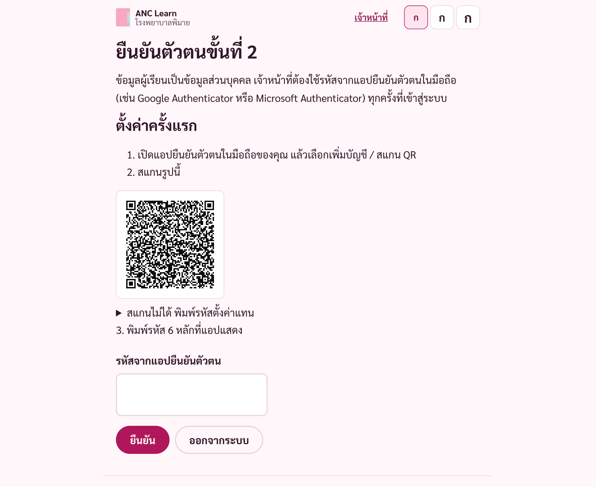
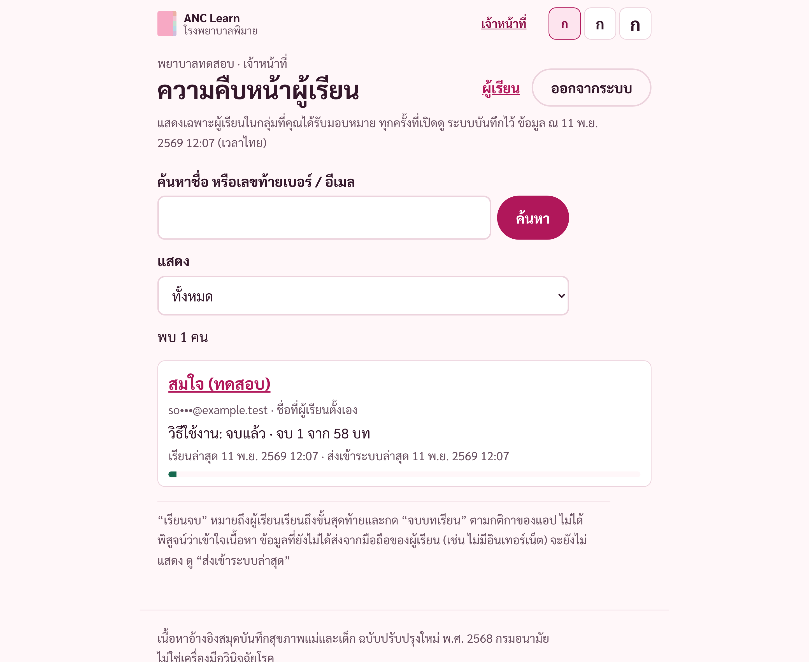
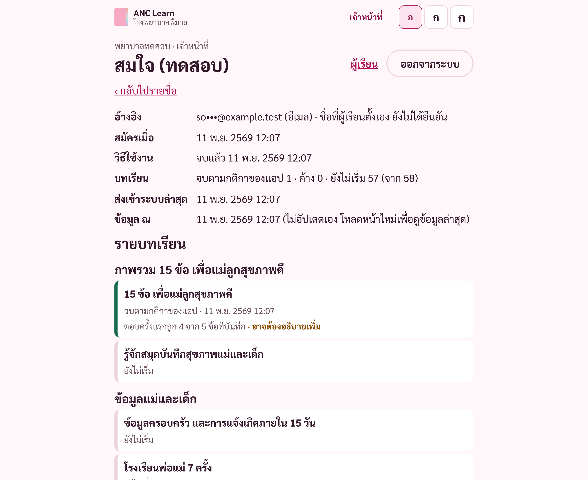

# คู่มือเจ้าหน้าที่: ดูความคืบหน้าผู้เรียน (ANC Learn)

> ฉบับร่าง (11 พ.ย. 2569) ระบบบัญชียังไม่เปิดใช้จริง ภาพประกอบมาจากแอปจริงในเครื่องทดสอบ ใช้ชื่อและอีเมลสมมุติ
> ยังไม่ได้ทดสอบการใช้งานกับเจ้าหน้าที่จริง

## ก่อนเริ่ม
- ผู้ดูแลระบบต้องสร้างบัญชีเจ้าหน้าที่ด้วย **อีเมลงานของคุณ** ก่อน แล้วคุณเปิดใช้บัญชีภายใน 7 วัน
- ต้องมีแอปยืนยันตัวตนในมือถือ เช่น Google Authenticator หรือ Microsoft Authenticator (ฟรี)
- ใช้อินเทอร์เน็ตทุกครั้ง หน้าเจ้าหน้าที่ไม่ทำงานแบบออฟไลน์

## 1. เข้าสู่ระบบอย่างปลอดภัย
1. เปิดแอป → ด้านล่างของหน้า “วิธีใช้งานและช่วยเหลือ” → **สำหรับเจ้าหน้าที่โรงพยาบาล** (หรือไปที่ `/staff`)
2. พิมพ์อีเมลงานที่ผู้ดูแลระบบใช้สร้างบัญชี → **ส่งรหัส** → เปิดอีเมล “รหัสยืนยัน ANC Learn” → พิมพ์รหัส 6 หลัก → **ยืนยันรหัส**
3. ครั้งแรก: สแกน QR ด้วยแอปยืนยันตัวตน แล้วพิมพ์รหัส 6 หลักจากแอป ครั้งต่อไป: พิมพ์รหัสจากแอปอย่างเดียว

ห้ามบอกรหัสใด ๆ กับผู้อื่น และห้ามขอรหัสยืนยันจากผู้เรียน

## 2. หาผู้เรียน
หน้า **ความคืบหน้าผู้เรียน** แสดงเฉพาะผู้เรียนในกลุ่มที่คุณได้รับมอบหมาย (เช่น “คลินิกฝากครรภ์”)
- ค้นหาด้วยชื่อ หรือเลข 4 ตัวท้ายของเบอร์ / ต้นอีเมล
- “แสดง” เลือก: มีบทที่เรียนค้าง / ยังไม่เริ่มบทเรียน / ยังไม่จบวิธีใช้งาน

ถ้าไม่พบผู้เรียนที่ควรเห็น ให้ผู้ดูแลระบบเพิ่มผู้เรียนคนนั้นเข้ากลุ่มของคุณ ทุกครั้งที่เปิดดู ระบบบันทึกชื่อคุณไว้

## 3. ดูความคืบหน้า
แตะชื่อผู้เรียน จะเห็น: วิธีใช้งาน, จำนวนบทที่จบ / ค้าง / ยังไม่เริ่ม (จาก 58 บท), รายบทเรียนตามหมวดของสมุด, ผลแบบทดสอบที่บันทึกไว้, วิดีโอ, และกิจกรรมล่าสุด

## 4. อ่านสถานะให้ถูก
| ข้อความ | ความหมาย |
|---|---|
| จบตามกติกาของแอป | ผู้เรียนไปถึงขั้นสุดท้ายและกด “จบบทเรียน” **ไม่ได้พิสูจน์ว่าเข้าใจ** |
| กำลังเรียน (ขั้นที่ x จาก y) | เปิดบทแล้ว ยังไม่จบ |
| ยังไม่เริ่ม | ไม่มีข้อมูลบทนี้ในบัญชี |
| อาจต้องอธิบายเพิ่ม | มีข้อที่ตอบครั้งแรกไม่ถูก ใช้เป็นหัวข้อพูดคุย **ไม่ใช่การวินิจฉัย และไม่ได้บอกว่าผู้เรียนไม่ปลอดภัย** |
| ไม่มีข้อมูลคำตอบ | ไม่มีคำตอบที่บันทึกไว้ (เช่น นำเข้าจากเครื่อง หรือเรียนก่อนเปิดใช้บัญชี) |
| ชื่อที่ผู้เรียนตั้งเอง | ระบบไม่ได้ยืนยันตัวตนว่าเป็นผู้ป่วยคนใด ยืนยันชื่อกับผู้เรียนก่อนพูดถึงข้อมูล |
| วิดีโอ “เล่นแล้ว x%” | วัดจากช่วงที่เล่นจริง การกดข้ามไม่นับ แต่ไม่ได้พิสูจน์ว่าตั้งใจดู |

## 5. ข้อมูลเก่าหรือยังไม่ส่ง
- **ส่งเข้าระบบล่าสุด** = เวลาที่ข้อมูลจากมือถือผู้เรียนมาถึงระบบ ถ้านานแล้ว ข้อมูลอาจไม่ครบ (เช่น มือถือไม่มีอินเทอร์เน็ต)
- **ข้อมูล ณ** = เวลาที่คุณเปิดหน้านี้ หน้าไม่อัปเดตเอง โหลดหน้าใหม่เพื่อดูข้อมูลล่าสุด
- เวลาในรายการกิจกรรมเป็นเวลาในมือถือของผู้เรียน

## 6. ออกจากระบบ (คอมพิวเตอร์ใช้ร่วมกัน)
กด **ออกจากระบบ** มุมขวาบนทุกครั้งที่ใช้เสร็จ อย่าปิดแค่แท็บ อย่าให้เบราว์เซอร์จำรหัส และอย่าถ่ายภาพหน้าจอข้อมูลผู้เรียนส่งต่อ
